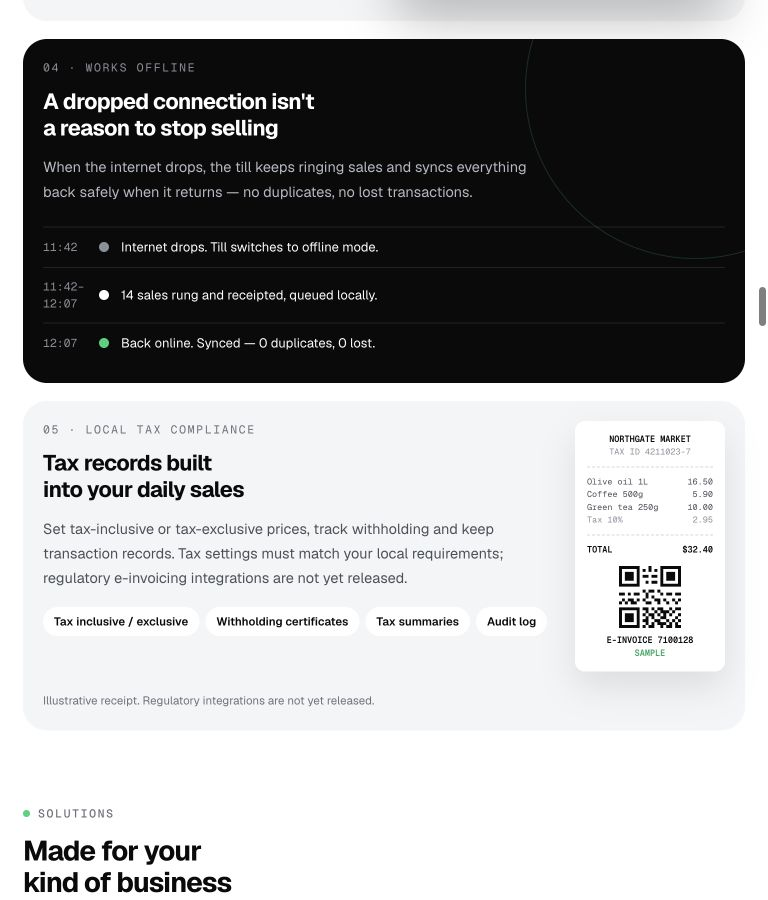
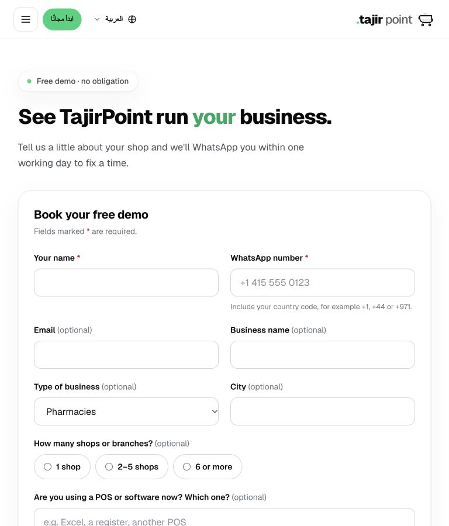
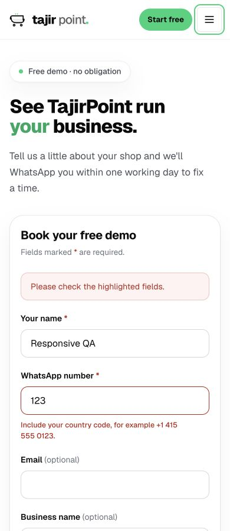

# International launch and responsive review

Reviewed 14 October 2026 against the local production build. General health after fixes: no page-wide horizontal overflow found in the checked viewport matrix; core navigation and discovery interactions worked. This is a frontend launch review, not a claim that the entire POS or every jurisdiction is certified for launch.

## Reviewed areas

1. **Homepage and product discovery.** Checked the hero, business grid, feature illustrations, offline/tax cards, solution tabs, back office, device/language section, marketplace, migration, pricing and FAQ. Replaced hard minimum grid widths with viewport-safe columns. Kept the tax card readable on tablets and stacked its receipt on small phones. Fixed long CTA wrapping, tab-panel shrinkage and search control sizing.
2. **International acquisition.** Removed Pakistan-only phone guessing and added country-code guidance, 16px form controls, local-time scheduling and the visitor's IANA time zone in the booking request message. Checked business/migration URL preselection, invalid-phone errors and retained field values. Language switching preserves query strings and hashes. English-only forms, feature pages, legal content and docs now declare their actual language and reading direction within RTL routes.
3. **Credibility and content.** Replaced six artificial merchant photographs with genuine shop/payment/warehouse photography, with source/license records in `public/images/PHOTO-CREDITS.json`. Replaced empty media placeholders and development filenames with purposeful feature illustrations. Labelled the interactive hero as sample data. Reconciled marketplace statuses with the backend release configuration, clarified regional payment availability, and removed claims of universal certified e-invoicing. Preserved the operator's actual legal identity and location. Pricing remains sourced from the live plans API; a note clarifies that unreleased add-ons remain unavailable regardless of plan.
4. **Public pages and developer reference.** Checked all 46 English public routes at 320 × 900 and 768 × 900, plus representative 390/1024px and Arabic/Urdu routes. Kept code and comparison tables scrollable inside their own panels. Fixed mobile docs drawer sizing and localized navigation. Initialized the docs layout locale to retain static generation.

## Verification

- 114 browser layout checks recorded in [route-checks.json](route-checks.json), including the final smoke checks after the RTL corrections. All document widths matched the viewport. Intentional clipped marquees and internally scrollable code blocks are identified separately.
- Visually inspected representative phone/tablet views, traversed the entire phone homepage, and confirmed its loaded images were not broken. Individual route sections were not all inspected pixel by pixel.
- Browser interactions: mobile menu open/Escape/close; documentation drawer navigation/close; extension search/clear; solution tab selection; Arabic receipt selection and Home-key navigation; monthly/yearly pricing; FAQ expansion; booking validation; locale switching with business/migration parameters preserved.
- `pnpm lint`: passed.
- `pnpm test`: 80 tests passed across 5 files, including international phone normalization and booking time-zone payload coverage.
- `pnpm build`: passed, 146 static pages generated, TypeScript compilation passed. Docs remain statically generated.
- Updated existing Playwright regression definitions for business counts, form guidance and English route resolution; those suites were not executed. Browser QA used CUA.
- The production preview must bind to `localhost`, or the deployment's normal hostname, rather than the literal `127.0.0.1`. The latter exposed a Next/next-intl local rewrite hostname mismatch. Binding the preview to `localhost` resolved it without weakening framework security or downgrading dependencies. See the [upstream investigation](https://github.com/vectorize-io/hindsight/pull/1934). Retired-language redirects stay in config; next-intl owns the normal default-English prefix redirect.

## Evidence

## Backend icon package

Saved `/Users/mac/Downloads/TajirPoint-extension-icons-2026-10-14.zip`: 34 icons, each exported as a 512 × 512 PNG named to match `Extension.slug`, plus original website artwork, manifest, source/license records and backend import instructions. Verified archive CRC, icon count and dimensions. Brand geometry and colors are retained; PostEx has the same dark backing as the website. Custom PNGs are resampled from the optimized website assets; originals are included. The reproducible packaging script is `scripts/package-extension-icons.mjs`.

## Remaining boundaries

No real lead/contact message, payment, account signup or backend icon upload was performed. Viewport testing used the desktop browser, not physical iOS/Android hardware. This was not a full WCAG, security, tax/legal or production infrastructure audit. Some secondary content and API-sourced plan descriptions remain English on localized routes; English content is explicitly marked where reviewed rather than presented as a completed translation.
